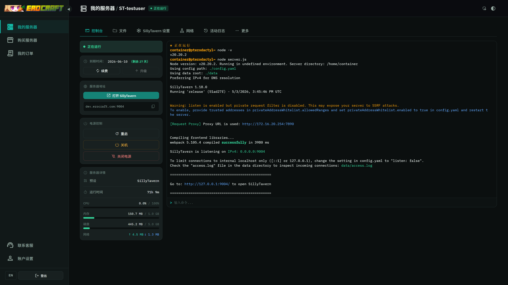

# Erocraft Manager

[中文](README.zh-CN.md) · **English**



Server rental management platform whose only runtime dependency is Wings. Adds an end-user UI for console / files / billing / registration / renewal / live support, plus an admin console for servers, users, hosts, certificates, alerting, notifications, and billing.

**Key features:**

- **Server lifecycle** — create / suspend / delete / reinstall with Wings; real-time console (WebSocket), file manager, startup variable editor
- **Billing & plans** — subscription plans, trial conversion, unified payment gateway checkout, per-payment refunds, and delivery tracking
- **Coupons & referral** — coupon templates (fixed-amount / percentage), invite codes with referral rewards
- **Free LLM quota** — per-plan AI API quota via NewAPI gateway; keys provisioned automatically on order, managed by admins (reset / revoke / adjust quota & models)
- **Live support & mini-program** — built-in customer support chat (text + image attachments) and WeChat mini-program account binding / checkout endpoints
- **Tunnels** — Cloudflare tunnel management per server (user-side + admin-side)
- **Certificates** — acme.sh integration with source scanning, multi-target deployment (local file / remote nginx), webhook-based renewal
- **Monitoring & alerting** — per-node host metrics (CPU / memory / disk / network), configurable alert thresholds, probe health checks, and multi-channel notifications (email / WeCom)
- **Multi-language** — Chinese (zh-CN) and English (en) with full i18n coverage

---

## 1. Overview

### 1.1 Components

This repository ships two independently deployable units:

| Unit | Path | Purpose |
|---|---|---|
| Manager | repo root | Backend API + scheduled jobs + Vue SPA. |
| Agent | `agent/` | Per-node host metrics, probes, certificate deployment, Wings service control. Runs on every managed host. |

The Manager backend runs as two independent OS processes sharing the same `app/` codebase and database:

- `manager-web`: FastAPI + Uvicorn listening on `:5001` (`--workers 1`), serving REST APIs, console WebSockets, and support SSE streams.
- `manager-jobs`: Single-instance APScheduler process running metrics collection, notification dispatch, order/refund retries, auto-suspend/delete, certificate scans, etc.

### 1.2 External Dependencies

**Hard runtime dependencies**:

| Dependency | Used for |
|---|---|
| Wings | Container lifecycle, power, console, files (per node; Manager calls Wings HTTPS API and console WS directly) |
| MySQL / MariaDB | Primary datastore. Manager-owned tables use the `manager_` prefix and coexist in the same database as Pterodactyl Panel tables |
| nginx | Public reverse proxy and SPA static file server |
| acme.sh | Certificate issuance / renewal, invoked by Manager via CLI |

**Relationship with Pterodactyl Panel**: Manager runs independently of the Panel process and interacts with the cluster only through MySQL, Wings, and Agent. The schema of `users`, `servers`, `nodes`, `allocations`, `egg_variables`, `server_variables`, and the Laravel encryption format of `nodes.daemon_token` follow Wings ecosystem conventions. Pterodactyl Panel may be co-deployed on the same database as a low-level fallback.

### 1.3 Process Topology

```
            browser
              │
              ↓
         nginx :80/:443
              │
   ┌──────────┴───────────┐
   │                      │
   ↓                      ↓
SPA (static files)   manager-web :5001  ──direct R/W──→  MySQL
                          │
                          ├──HTTPS──→  Wings :8443    (per node)
                          │
                          └──HTTPS──→  Agent :48765   (per host)
                          ↑
                          │
                manager-jobs (APScheduler)  ─── periodic agent pull / automation
```

### 1.4 Tech Stack

| Layer | Choice |
|---|---|
| Backend | Python 3.12, FastAPI, SQLAlchemy 2 (async), Pydantic v2, APScheduler, Alembic |
| Frontend | Vue 3.5, Vite 6, TypeScript, vue-i18n, ECharts, xterm.js, CodeMirror 6 |
| Database | MySQL / MariaDB |
| Agent | Python 3.12+, FastAPI, httpx, PyYAML, cryptography (stdlib `/proc` metrics, no psutil) |
| Certificates | acme.sh |

### 1.5 Repository Layout

```
app/                FastAPI backend
  api/routers/      HTTP routes
  services/         business logic (panel_db, wings, agent_client, cert_manager, billing, notifications, ...)
  jobs/             manager-jobs entrypoint and scheduled tasks
  schemas/          Pydantic models
  db/               ORM models + AsyncSession
  core/             config, security, contracts, time helpers
agent/              Node agent source
alembic/            Database migrations
contracts/          Shared error codes and wire models (Manager / Agent / Frontend)
frontend/           Vue 3 SPA
scripts/            CI contract generators and release deployment scripts (scripts/deploy/)
templates/          Email template JSON
.env.example        Environment template
```

---

## 2. Deployment

### 2.1 Prerequisites

- Linux x86_64 (Debian 12+ / Ubuntu 22.04+)
- At least one Wings node and a reachable MySQL / MariaDB instance (panel schema initialized)
- Python 3.12+, Node.js 22+, nginx
- acme.sh installed on the Manager host

### 2.2 Manager Backend

```bash
sudo mkdir -p /opt/erocraft_manager
sudo chown $USER:$USER /opt/erocraft_manager
git clone https://github.com/vvb7456/Erocraft_Manager.git /opt/erocraft_manager
cd /opt/erocraft_manager

python3.12 -m venv venv
venv/bin/pip install --upgrade pip
venv/bin/pip install -r requirements.txt

cp .env.example .env
$EDITOR .env
```

Required `.env` fields:

| Variable | Description |
|---|---|
| `SECRET_KEY` | ≥32 chars. Generate with `python -c "import secrets; print(secrets.token_hex(32))"` |
| `DB_HOST` / `DB_PORT` / `DB_USER` / `DB_PASSWORD` / `DB_NAME` | Database connection |
| `PANEL_APP_KEY` | Laravel `APP_KEY` used to decrypt `nodes.daemon_token` (must match Panel's `.env` `APP_KEY`) |
| `CERT_ACME_SH_HOME` | acme.sh installation directory |
| `CERT_ACME_SH_BIN` | acme.sh executable path |

Run database migrations and start the systemd services:

```bash
venv/bin/alembic -c alembic.ini upgrade head
sudo systemctl start erocraft-manager-web erocraft-manager-jobs
sudo systemctl status erocraft-manager-web erocraft-manager-jobs
```

*(Note: Database migrations are executed explicitly and do not run automatically on service startup.)*

### 2.3 Frontend

```bash
cd frontend
npm ci
npx vite build           # outputs to ../static/dist/
bash build-fonts.sh      # rebuild Material Symbols icon font subset
```

### 2.4 nginx

Minimal reverse-proxy configuration (add `listen 443 ssl;` and certificate paths for HTTPS):

```nginx
server {
    listen 80;
    server_name panel.example.com;

    # API, console WS, and support SSE
    location /api/ {
        proxy_pass http://127.0.0.1:5001;
        proxy_http_version 1.1;
        proxy_set_header Upgrade $http_upgrade;
        proxy_set_header Connection "upgrade";
        proxy_set_header Host $host;
        proxy_set_header X-Forwarded-For $proxy_add_x_forwarded_for;
        proxy_set_header X-Forwarded-Proto $scheme;
        proxy_read_timeout 120s;
    }

    location / {
        root /opt/erocraft_manager/static/dist;
        try_files $uri /index.html;
    }
}
```

### 2.5 Per-Node Agent

Every managed host runs an Agent from `/opt/erocraft-agent` (distinct from the in-repo `agent/` directory):

```bash
sudo mkdir -p /opt/erocraft-agent
cd /opt/erocraft-agent
python3 -m venv venv
venv/bin/pip install -r /path/to/erocraft_manager/agent/requirements.txt
sudo cp -r /path/to/erocraft_manager/agent ./agent

sudo cp agent/config.example.yaml ./agent.yaml
sudo $EDITOR ./agent.yaml
```

Key `agent.yaml` fields:

| Field | Meaning |
|---|---|
| `agent.role` | `wings_node` or `generic_host` |
| `agent.bind` | Listen address; default `0.0.0.0:48765` |
| `agent.token` | Bearer token (auto-generated on first start if left empty; Manager stores it encrypted) |
| `agent.allow_ips` | Optional source-IP allowlist |
| `wings.config_path` | Path to `/etc/pterodactyl/config.yml` (used when `role=wings_node`) |
| `cert_install_targets` | Optional named file targets (`cert_path`, `key_path`, `reload_cmd`) for certificate deployment |

Enable the systemd service:

```bash
sudo cp agent/erocraft-agent.service /etc/systemd/system/
sudo systemctl daemon-reload
sudo systemctl enable --now erocraft-agent
```

Register the host in **Admin → Hosts → New** with its endpoint URL (`https://<node>:48765`) and Bearer token.

### 2.6 Release Deployment (`scripts/deploy/`)

Production hosts deploy pre-built GitHub Release tarballs (`frontend-dist-*`, `manager-backend-*`, `agent-*`) via atomic `current` symlink switching:

```bash
bash /opt/erocraft/deploy/deploy-frontend.sh [tag]
bash /opt/erocraft/deploy/deploy-backend.sh  [tag]
bash /opt/erocraft/deploy/deploy-agent.sh    [tag]
```

Passing `main` resolves to the latest `main-<sha>` prerelease. Each script keeps the most recent 5 releases under `releases/<tag>/` and rolls back automatically if the health check fails.

### 2.7 Database Migrations

All Manager-owned tables use the `manager_` prefix; Alembic migrations operate only on those tables:

```bash
venv/bin/alembic -c alembic.ini current
venv/bin/alembic -c alembic.ini history
venv/bin/alembic -c alembic.ini upgrade head
venv/bin/alembic -c alembic.ini revision --autogenerate -m "..."
```

---

## 3. Operations

### 3.1 Service Control & Logs

```bash
sudo systemctl {start|stop|restart|status} erocraft-manager-web erocraft-manager-jobs
```

| File / command | Contents |
|---|---|
| `journalctl -u erocraft-manager-web -f` or `logs/manager-web.log` | Web API & access logs |
| `journalctl -u erocraft-manager-jobs -f` or `logs/manager-jobs.log` | Scheduled job logs |
| `journalctl -u erocraft-agent -f` | Node agent logs |
| `journalctl -u wings -f` | Wings daemon logs |

Log level is controlled by `LOG_LEVEL` in `.env` (`DEBUG / INFO / WARNING / ERROR`).

### 3.2 Scheduled Jobs

`manager-jobs` runs the following periodic tasks ( `.env` provides bootstrap defaults; runtime overrides are stored in the database via **Admin → Settings**):

| Job | Trigger | Description |
|---|---|---|
| Metrics collection | Every `MONITOR_INTERVAL_SEC` (default 60s) | Pulls `/v1/metrics` from all enabled hosts and evaluates alert rules |
| Notification dispatch | Every 5s | Sends queued email / WeCom alerts and customer notifications |
| Billing order sync & retries | Every 1–3m | Closes expired unpaid orders, syncs gateway status, retries pending server provisioning / refunds |
| Certificate scans & auto-dispatch | Every 10m | Scans acme.sh sources and agent targets; auto-deploys updated certificates |
| Token & metrics cleanup | Hourly | Purges expired auth/session tokens and prunes monitoring samples older than `MONITOR_RETENTION_DAYS` (default 30 days) |
| Server lifecycle & reminders | Daily at `AUTOMATION_RUN_HOUR:MINUTE` | Runs auto-suspend, grace-period auto-delete, and expiration reminder emails |
| Certificate expiry alert | Daily | Checks upcoming certificate expirations and notifies admins |

### 3.3 Certificates

- **Source**: Scans `CERT_ACME_SH_HOME` and acme.sh metadata
- **Renewal**: Invokes `CERT_ACME_SH_BIN`
- **Targets**: Wings default TLS paths or named certificate file targets on remote hosts (written atomically via Agent with `reload_cmd`)
- **Webhook**: acme.sh `reloadcmd` / deploy hook can call `POST /api/certificates/webhook/renewed` with `X-Cert-Webhook-Token` (`CERT_WEBHOOK_TOKEN`) to trigger immediate source rescan and deployment

### 3.4 Hosts / Nodes

| Action | Path |
|---|---|
| Add a host | Admin → Hosts → New (endpoint URL + token) |
| Edit Wings config | Host detail → Wings tab; writes `nodes` row then pushes to Wings `/api/update` |
| Restart Wings | Host detail → Wings → Restart (Agent runs `systemctl restart wings`) |
| Port allocations | Host detail → Allocations tab |
| Alert thresholds | Host detail → Settings tab (per-host overrides on top of global defaults) |

### 3.5 Backups

| Item | Command / path |
|---|---|
| Database | `mysqldump --single-transaction <DB_NAME> > db.sql` |
| Config | `.env`, `agent.yaml` (per host), nginx site configs |
| Support attachments | `SUPPORT_IMAGE_DIR` (default `/opt/erocraft_manager/storage/support`, capped by `SUPPORT_IMAGE_MAX_MB`) |
| Certificates | `CERT_ACME_SH_HOME` |
| Container volumes | `/var/lib/pterodactyl/volumes` on each Wings node |

### 3.6 Troubleshooting

| Symptom | Where to look |
|---|---|
| Web service fails to start | `journalctl -u erocraft-manager-web` or `logs/manager-web.log`; verify required `.env` keys and Alembic migration state |
| User console fails to connect | Verify nginx forwards `Upgrade` / `Connection` headers; verify Wings port reachability |
| No monitoring data | Host detail → Settings → Probe; `systemctl status erocraft-agent`; verify token and TLS hostname match |
| Certificate not renewed | Search `cert` in `logs/manager-jobs.log`; test manually with `${CERT_ACME_SH_BIN} --renew -d <domain> --force` |
| Server creation fails | Search `lifecycle` in `logs/manager-web.log`; failed creations compensate and roll back automatically |
| Panel field decryption errors | Confirm `PANEL_APP_KEY` matches the `APP_KEY` used when `nodes.daemon_token` was encrypted |

### 3.7 Common Commands

```bash
venv/bin/alembic -c alembic.ini current                      # current migration revision
tail -f logs/manager-jobs.log                                # tail jobs log
curl -fsS http://127.0.0.1:5001/api/version                  # health check
python3 scripts/generate-contracts.py --check                # verify shared error-code contracts
```

---

## License

See [LICENSE](LICENSE).
