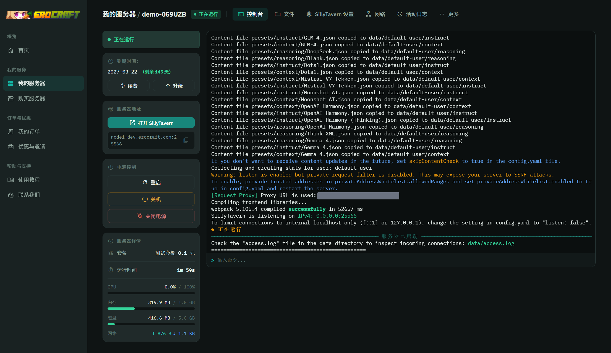

# Erocraft Manager

[中文](README.zh-CN.md) · **English**



Server rental and container hosting platform powered by Wings. Provides an end-user portal for console, files, billing, renewals, and live support, alongside an admin console for servers, presets, nodes, hosts, certificates, monitoring, notifications, and billing.

**Key features:**

- **Server lifecycle** — create, suspend, delete, and reinstall containers via Wings; WebSocket console, file manager, SFTP auth, and startup variables
- **Presets & nodes** — Nests, Eggs (config/script inheritance, JSON import/export, variable validation), Locations, Wings Nodes, and port allocations
- **Billing & plans** — subscription plans, trial conversion, payment gateway checkout, per-payment refunds, and redemption codes
- **Coupons & referral** — fixed/percentage coupon templates and invite codes with referral rewards
- **Free LLM quota** — per-plan AI API quota via NewAPI, automatically provisioned on checkout
- **Live support & mini-program** — built-in customer chat (text + images) and WeChat mini-program binding / checkout
- **Tunnels & certificates** — per-server Cloudflare tunnels and automated `acme.sh` issuance, renewal, and multi-host deployment
- **Monitoring & alerting** — host metrics, probes, threshold rules, and email / WeCom notifications
- **Multi-language** — Chinese (`zh-CN`) and English (`en`)

---

## 1. Overview

### 1.1 Components

| Unit | Path | Purpose |
|---|---|---|
| Manager | repo root | Backend API (`manager-web` on `:5001`), scheduled jobs (`manager-jobs`), and Vue SPA |
| Agent | `agent/` | Per-host metrics, probes, certificate deployment, and Wings service control (`:48765`) |

### 1.2 Runtime Dependencies

| Dependency | Purpose |
|---|---|
| Wings | Container daemon per node (REST/WebSocket control + `/api/remote/*` callbacks) |
| MySQL / MariaDB | Primary datastore |
| nginx | Reverse proxy and SPA static server |
| acme.sh | Certificate issuance and renewal CLI |

### 1.3 Relationship with the Pterodactyl Ecosystem

Erocraft Manager runs completely standalone without Pterodactyl Panel. It implements both the Wings control client and the `/api/remote/*` daemon callback protocol directly, while staying compatible with standard Wings binaries, node `config.yml` files, `PTDL_v1`/`PTDL_v2` Egg JSON presets, and the Wings ecosystem database schema (allowing either fresh deployments or in-place takeover of an existing Pterodactyl database).

### 1.4 Process Topology

```
            browser
              │
              ↓
         nginx :80/:443
              │
   ┌──────────┴───────────┐
   │                      │
   ↓                      ↓
SPA (static files)   manager-web :5001  ──R/W──→  MySQL
                          │   ↑
     HTTPS + WS (/api/*)  │   │  HTTPS (/api/remote/*)
                          ↓   │
                      Wings :8443       (per node)
                          │
                     Agent :48765       (per host, pulled by Manager)
                          ↑
                          │
                manager-jobs (APScheduler)
```

### 1.5 Tech Stack & Layout

- **Backend**: Python 3.12, FastAPI, SQLAlchemy 2 (async), Pydantic v2, APScheduler, Alembic
- **Frontend**: Vue 3.5, Vite 6, TypeScript, vue-i18n, ECharts, xterm.js, CodeMirror 6
- **Agent**: Python 3.12+, FastAPI, httpx, PyYAML, cryptography (stdlib `/proc` metrics)

```
app/          FastAPI backend (api/, services/, jobs/, schemas/, db/, core/)
agent/        Host agent source
alembic/      Database migrations
contracts/    Shared error codes and wire schemas
frontend/     Vue 3 SPA
scripts/      Contract checks and release deploy scripts (scripts/deploy/)
templates/    Email template JSON
```

---

## 2. Deployment

### 2.1 Backend

```bash
git clone https://github.com/vvb7456/Erocraft_Manager.git /opt/erocraft_manager
cd /opt/erocraft_manager

python3.12 -m venv venv
venv/bin/pip install -U pip -r requirements.txt

cp .env.example .env
$EDITOR .env
```

Required `.env` variables:

| Variable | Description |
|---|---|
| `SECRET_KEY` | ≥32 chars (`python -c "import secrets; print(secrets.token_hex(32))"`) |
| `DB_HOST` / `DB_PORT` / `DB_USER` / `DB_PASSWORD` / `DB_NAME` | Database credentials |
| `PANEL_APP_KEY` | AES-256-CBC key (`base64:...`) for node token encryption (`python -c "import base64, os; print('base64:' + base64.b64encode(os.urandom(32)).decode())"`) |
| `CERT_ACME_SH_HOME` / `CERT_ACME_SH_BIN` | `acme.sh` directory and binary path |

Run migrations and start services:

```bash
venv/bin/alembic -c alembic.ini upgrade head
sudo systemctl start erocraft-manager-web erocraft-manager-jobs
```

### 2.2 Frontend & nginx

```bash
cd frontend
npm ci
npx vite build           # outputs to ../static/dist/
bash build-fonts.sh      # rebuild Material Symbols subset
```

```nginx
server {
    listen 80;
    server_name console.example.com;
    client_max_body_size 100m;

    location /api/ {
        proxy_pass http://127.0.0.1:5001;
        proxy_http_version 1.1;
        proxy_set_header Upgrade $http_upgrade;
        proxy_set_header Connection "upgrade";
        proxy_set_header Host $host;
        proxy_set_header X-Real-IP $remote_addr;
        proxy_set_header X-Forwarded-For $proxy_add_x_forwarded_for;
        proxy_set_header X-Forwarded-Proto $scheme;
        proxy_buffering off;
        proxy_read_timeout 300s;
    }

    location / {
        root /opt/erocraft_manager/static/dist;
        try_files $uri /index.html;
    }
}
```

### 2.3 Host Agent & Wings Nodes

Deploy Agent to `/opt/erocraft-agent` on each managed host:

```bash
sudo mkdir -p /opt/erocraft-agent && cd /opt/erocraft-agent
python3 -m venv venv
venv/bin/pip install -r /path/to/erocraft_manager/agent/requirements.txt
sudo cp -r /path/to/erocraft_manager/agent ./agent
sudo cp agent/config.example.yaml ./agent.yaml
sudo cp agent/erocraft-agent.service /etc/systemd/system/
sudo systemctl daemon-reload && sudo systemctl enable --now erocraft-agent
```

To onboard a Wings node:
1. Create a Location and Node under **Admin → Hosts → Locations / Wings Nodes**, export its `config.yml` to `/etc/pterodactyl/config.yml`, and start `wings`.
2. Register the host under **Admin → Hosts → New** with its Agent URL (`https://<host>:48765`), token, and bound node.

### 2.4 Release Upgrades (`scripts/deploy/`)

```bash
bash /opt/erocraft/deploy/deploy-frontend.sh [tag]
SKIP_ALEMBIC=1 bash /opt/erocraft/deploy/deploy-backend.sh [tag]
bash /opt/erocraft/deploy/deploy-agent.sh    [tag]
```

Omitting `tag` (or passing `main`) deploys the latest `main-<sha>` build, keeps the last 5 releases under `releases/<tag>/`, and rolls back automatically on failed health checks. Omit `SKIP_ALEMBIC=1` when applying new database migrations.

---

## 3. Operations

### 3.1 Services & Logs

```bash
sudo systemctl {start|stop|restart|status} erocraft-manager-web erocraft-manager-jobs
journalctl -u erocraft-manager-web -f        # or tail -f logs/manager-web.log
journalctl -u erocraft-manager-jobs -f       # or tail -f logs/manager-jobs.log
journalctl -u erocraft-agent -f
journalctl -u wings -f
```

### 3.2 Scheduled Jobs (`manager-jobs`)

| Job | Interval | Purpose |
|---|---|---|
| Metrics collection | 60s | Pull `/v1/metrics` from enabled hosts and evaluate alert rules |
| Notification dispatch | 5s | Deliver queued email and WeCom notifications |
| Billing sync & retries | 1–3m | Close expired orders, sync gateway state, retry provisioning and refunds |
| Certificate scan & deploy | 10m | Scan `acme.sh` sources and auto-deploy renewed certificates |
| Retention cleanup | 1h | Prune expired tokens, old metrics (30d), and server activity logs (90d) |
| Lifecycle & reminders | Daily | Auto-suspend expired servers, auto-delete past grace period, send reminders |

### 3.3 Common Checks & Backups

```bash
curl -fsS http://127.0.0.1:5001/api/version
venv/bin/alembic -c alembic.ini current
python3 scripts/generate-contracts.py --check
python3 scripts/check-agent-contracts.py
mysqldump --single-transaction --no-tablespaces --routines <DB_NAME> > db.sql
```

---

## License

See [LICENSE](LICENSE).
