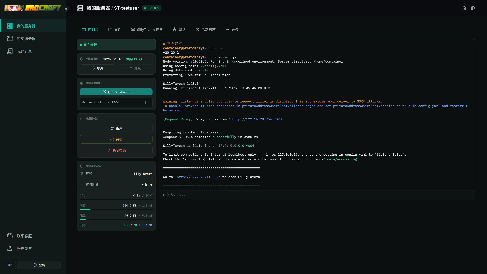

# Erocraft Manager

[中文](README.zh-CN.md) · **English**



Server rental management platform whose only runtime dependency is Wings. Adds an end-user UI for console / files / billing / registration / renewal, plus an admin console for servers, users, hosts, certificates, alerting and billing.

**Key features:**

- **Server lifecycle** — create / suspend / delete / reinstall with Wings; real-time console (WebSocket), file manager, startup variable editor
- **计费与套餐** — 订阅套餐、试用转正、统一支付网关收银、逐笔退款与交付确认
- **Coupons & referral** — coupon templates (fixed-amount / percentage), invite codes with referral rewards
- **Free LLM quota** — per-plan AI API quota via NewAPI gateway; keys provisioned automatically on order, managed by admins (reset / revoke / adjust quota & models)
- **Tunnels** — Cloudflare tunnel management per server (user-side + admin-side)
- **Certificates** — acme.sh integration with source scanning, multi-target deployment (local / remote nginx / Synology DSM), webhook-based renewal
- **Monitoring & alerting** — per-node host metrics (CPU / memory / disk), configurable alert thresholds, probe health checks
- **Multi-language** — Chinese (zh-CN) and English (en) with full i18n coverage

---

## 1. Overview

### 1.1 Components

This repository ships two independently deployable units:

| Unit | Path | Purpose |
|---|---|---|
| Manager | repo root | Backend API + scheduled jobs + Vue SPA. Runs on host A. |
| Agent | `agent/` | Per-node host metrics, probes, certificate deployment, Wings service control. Runs on every Wings node. |

The Manager backend is two processes:

- `manager-web`：FastAPI + Uvicorn，监听 `:5001`，以 `--workers 1` 运行 REST、控制台 WebSocket 和客服 SSE。客服实时提醒使用本进程事件。
- `manager-jobs`: APScheduler in its own process. Runs metrics pull, auto-suspend, auto-delete, certificate renewals, etc.

Both share the same `app/` codebase and database, and run independently of each other.

`manager-jobs` 只运行一个实例，APScheduler 同一任务最多执行一个实例，通知发送依赖这个部署约定。

### 1.2 External Dependencies

**Hard runtime dependencies** :

| Dependency | Used for |
|---|---|
| Wings | Container lifecycle, power, console, files (per node; Manager calls `:8443` HTTPS and console WS directly) |
| MySQL / MariaDB | 结构化业务数据；Manager 表使用 `manager_` 前缀，与 Wings 所用的面板表共库。客服图片存放在本地磁盘。 |
| nginx | Public reverse proxy; also serves the SPA static files |
| acme.sh | Certificate issuance / renewal, invoked by Manager via CLI |

**Relationship with Pterodactyl Panel**: Manager runs independently of the Panel process and interacts with the system only through the database and Wings. The database table / column names Manager uses, and the Laravel encryption format of Wings's `daemon_token`, are de-facto conventions of the Wings ecosystem. Pterodactyl Panel may be co-deployed and share the same database; in that case Panel's admin UI can be kept as a low-level fallback. When deploying Manager alone, you are responsible for initializing the schema and aligning keys with Wings.

### 1.3 Process Topology

```
            browser
              │
              ↓
         nginx :80/:443
              │
   ┌──────────┴───────────┐
   │                      │
   ↓                      ↓
SPA (static files)   manager-web :5001  ──direct R/W──→  MySQL
                          │
                          ├──HTTPS──→  Wings :8443    (per node)
                          │
                          └──HTTPS──→  Agent :48765   (per node)
                          ↑
                          │
                manager-jobs (APScheduler)  ─── periodic agent pull / automation
```

### 1.4 Tech Stack

| Layer | Choice |
|---|---|
| Backend | Python 3.12, FastAPI, SQLAlchemy 2 (async), Pydantic v2, APScheduler, Alembic |
| Frontend | Vue 3.5, Vite 6, TypeScript, vue-i18n, ECharts, xterm.js, CodeMirror 6 |
| Database | MySQL / MariaDB |
| Agent | Python 3 + FastAPI + psutil + httpx |
| Certificates | acme.sh |

### 1.5 Repository Layout

```
app/                FastAPI backend
  api/routers/      HTTP routes
  services/         business logic (panel_db, wings, agent_client, cert_manager, billing, ...)
  jobs/             manager-jobs entrypoint and scheduler config
  schemas/          Pydantic models
  db/               ORM models + AsyncSession
  core/             config, security, time helpers
agent/              Node agent source
alembic/            Database migrations
frontend/           Vue 3 SPA
docs/               Architecture & design docs (ARCHITECTURE_V3 is authoritative)
templates/          Email template JSON
storage/support/    客服图片运行时目录（独立于 release）
manager.sh          Backend service control script
.env.example        Environment template
```

---

## 2. Deployment

### 2.1 Prerequisites

- Linux x86_64 (verified on Debian 12 / Ubuntu 22.04+)
- At least one Wings node and a reachable MySQL / MariaDB instance (schema follows Wings ecosystem conventions; typically initialized by Pterodactyl Panel)
- Python 3.12+, Node.js 22+, nginx
- Network reach from host A to that MySQL (local or remote)
- acme.sh installed

### 2.2 Manager Backend

```bash
sudo mkdir -p /opt/erocraft_manager
sudo chown $USER:$USER /opt/erocraft_manager
git clone https://github.com/vvb7456/Erocraft_Manager.git /opt/erocraft_manager
cd /opt/erocraft_manager

python3.12 -m venv venv
venv/bin/pip install --upgrade pip
venv/bin/pip install -r requirements.txt

cp .env.example .env
$EDITOR .env
```

Required `.env` fields:

| Variable | Description |
|---|---|
| `SECRET_KEY` | ≥32 chars. Generate with `python -c "import secrets; print(secrets.token_hex(32))"` |
| `DB_HOST` / `DB_PORT` / `DB_USER` / `DB_PASSWORD` / `DB_NAME` | Database connection |
| `PANEL_APP_KEY` | The Laravel `APP_KEY` used by the Wings ecosystem. Decrypts `nodes.daemon_token` and similar fields; if you share the database with Pterodactyl Panel, this must equal Panel's `.env` `APP_KEY`. |
| `CERT_ACME_SH_HOME` | acme.sh install directory |
| `CERT_ACME_SH_BIN` | acme.sh executable path |

Start:

```bash
venv/bin/alembic -c alembic.ini upgrade head
systemctl start erocraft-manager-web erocraft-manager-jobs
systemctl status erocraft-manager-web erocraft-manager-jobs
```

服务由 systemd 管理；部署时配置对应的 unit，日志可通过 `journalctl` 或生产的 `logs/` 目录查看。

### 2.3 Frontend

```bash
cd frontend
npm ci
npx vite build           # outputs to ../static/dist/
bash build-fonts.sh      # rebuild Material Symbols subset
```

### 2.4 nginx

Minimal config (add `listen 443 ssl;` + cert paths for HTTPS):

```nginx
server {
    listen 80;
    server_name panel.example.com;

    # Cert deployment endpoints can take >120s
    location /api/admin/certificates {
        proxy_pass http://127.0.0.1:5001;
        proxy_set_header Host $host;
        proxy_set_header X-Forwarded-For $proxy_add_x_forwarded_for;
        proxy_set_header X-Forwarded-Proto $scheme;
        proxy_read_timeout 400s;
    }

    # API + console WS
    location /api/ {
        proxy_pass http://127.0.0.1:5001;
        proxy_http_version 1.1;
        proxy_set_header Upgrade $http_upgrade;
        proxy_set_header Connection "upgrade";
        proxy_set_header Host $host;
        proxy_set_header X-Forwarded-For $proxy_add_x_forwarded_for;
        proxy_set_header X-Forwarded-Proto $scheme;
        proxy_read_timeout 120s;
    }

    location / {
        root /opt/erocraft_manager/static/dist;
        try_files $uri /index.html;
    }
}
```

### 2.5 Per-Node Agent

Every Wings node needs an Agent. By convention it runs from `/opt/erocraft-agent` (note the dash; distinct from the in-repo `agent/`).

```bash
sudo mkdir -p /opt/erocraft-agent
cd /opt/erocraft-agent
python3 -m venv venv
venv/bin/pip install -r /path/to/erocraft_manager/agent/requirements.txt
sudo cp -r /path/to/erocraft_manager/agent ./agent

sudo cp agent/config.example.yaml ./agent.yaml
sudo $EDITOR ./agent.yaml
```

Key `agent.yaml` fields:

| Field | Meaning |
|---|---|
| `agent.role` | `wings_node` / `generic_host` / `synology_dsm` |
| `agent.bind` | Listen address; default `0.0.0.0:48765` |
| `agent.token` | Bearer token. High-entropy random string. Manager stores it encrypted. |
| `agent.allow_ips` | Optional source-IP allowlist |
| `wings.config_path` | Required when `role=wings_node`; points to wings config |

systemd:

```bash
sudo cp agent/erocraft-agent.service /etc/systemd/system/
sudo systemctl daemon-reload
sudo systemctl enable --now erocraft-agent
```

Register: in admin → Hosts → New, enter the agent endpoint URL (`http://<node>:48765`) and token. A probe runs automatically on save.

### 2.6 Agent Redeploy

The running agent does not auto-sync from the repo; push changes manually with the helper script:

```bash
bash scripts/deploy/deploy-agent.sh              # local
bash scripts/deploy/deploy-agent.sh <node-host>  # remote node
```

### 2.7 Database Migrations

迁移显式执行，服务启动时不自动迁移：

```bash
venv/bin/alembic -c alembic.ini current
venv/bin/alembic -c alembic.ini history
venv/bin/alembic -c alembic.ini upgrade head
venv/bin/alembic -c alembic.ini revision --autogenerate -m "..."
```

All Manager-owned tables use the `manager_` prefix; migrations operate only on those tables.

---

## 3. Operations

### 3.1 Service Control

```bash
systemctl restart erocraft-manager-web erocraft-manager-jobs
systemctl status erocraft-manager-web erocraft-manager-jobs
```

数据库迁移显式执行：`venv/bin/alembic -c alembic.ini upgrade head`，服务启动时不自动迁移。

Web 停服先正常退出，最多等待 3 秒，超时后强制结束进程并断开长连接。部署脚本安装 `scripts/deploy/manager-web-stop.conf`；手动部署时执行：

```bash
install -D -m 644 scripts/deploy/manager-web-stop.conf /etc/systemd/system/erocraft-manager-web.service.d/stop.conf
systemctl daemon-reload
```

### 客服图片存储

`SUPPORT_IMAGE_DIR` 默认 `/opt/erocraft_manager/storage/support`，应使用服务可写、独立于版本目录的专用绝对路径。数据库仅保存文件名和类型，读取仍经过会话权限检查。单张最多 4 MiB，保留 PNG、JPEG、WebP 原文件。

`SUPPORT_IMAGE_MAX_MB` 默认 `1024`（1 GiB，最小 4 MiB），限制所有会话图片的合计大小。每次写入前按文件保存时间清理最旧图片，聊天文字保留，旧图显示图片不可用图标。需要保存图片备份时，单独备份此目录。

### 3.2 Logs

| File / command | Contents |
|---|---|
| `logs/manager-web.log` | uvicorn access + application |
| `logs/manager-jobs.log` | scheduler jobs |
| `journalctl -u erocraft-agent` | node agent |
| `journalctl -u wings` | Wings |

Log level controlled by `LOG_LEVEL` in `.env` (`DEBUG / INFO / WARNING / ERROR`).

### 3.3 Scheduled Jobs

`manager-jobs` runs:

| Job | Trigger | Source |
|---|---|---|
| Metrics pull (all hosts) | every `MONITOR_INTERVAL_SEC` (default 60) | `.env` + runtime setting |
| Metrics / resolved alert pruning | hourly | `MONITOR_RETENTION_DAYS` (default 30 days) |
| Auto-suspend / delete / reminder mail | daily at `AUTOMATION_RUN_HOUR:MINUTE` | runtime setting overrides |
| Certificate renewal & expiry alerts | daily | acme.sh + scanner |

`.env` is bootstrap fallback only. Runtime configuration lives in the database (admin → Settings).

监控按主机并发执行，每台主机独立保存指标、探针和最后在线时间，再用单独事务处理告警及通知入队。一台主机的超时或告警异常不会回滚其他主机的数据。Wings 公网探测最多尝试三次，单次总超时 5 秒，重试间隔为 2、4 秒。每台主机的整轮处理在采集周期结束前 5 秒截止，Agent 拉取预算为采集周期减 10 秒；默认 60 秒周期下分别为 55、50 秒。主机设置的拉取次数是此预算内的最大尝试次数。关闭告警规则只停止相应告警，停用主机才会停止采集。

### 3.4 Certificates

- **Source**: scan `CERT_ACME_SH_HOME` + acme.sh metadata
- **Renewal**: invokes `CERT_ACME_SH_BIN`
- **Targets**: local file / remote nginx (via Agent, with reload) / Synology DSM API
- **Webhook**: acme.sh `reloadcmd` or `deploy hook` calls `/api/public/cert-webhook`. Configure `CERT_WEBHOOK_TOKEN`.
- **Alert recipients**: `CERT_ALERT_EMAIL_ADMIN_IDS` or runtime setting

### 3.5 Hosts / Nodes

| Action | Path |
|---|---|
| Add a node | Admin → Hosts → New (endpoint + token) |
| Edit Wings config | Host detail → Wings tab; on save Manager writes the `nodes` table then pushes to wings `/api/update` |
| Restart Wings | Host detail → Wings → Restart (Agent triggers `systemctl restart wings`) |
| Allocations | Host detail → Allocations tab |
| Alert thresholds | Host detail → Settings tab (per-host overrides on top of global defaults) |

### 3.6 Backups

| Item | Command / path |
|---|---|
| Database | `mysqldump <DB_NAME> > db.sql` |
| Config | `.env`, `agent.yaml` (per node), nginx site files |
| Certificates | full `CERT_ACME_SH_HOME` |
| Container volumes | `/var/lib/pterodactyl/volumes` on each node |

### 3.7 Upgrade

```bash
cd /opt/erocraft_manager
git pull
venv/bin/pip install -r requirements.txt
cd frontend && npm ci && npx vite build && cd ..
venv/bin/alembic -c alembic.ini upgrade head
systemctl restart erocraft-manager-web erocraft-manager-jobs
bash scripts/deploy/deploy-agent.sh                # only when agent/ changed
```

### 3.8 Troubleshooting

| Symptom | Where to look |
|---|---|
| Web 服务启动失败 | `journalctl -u erocraft-manager-web` 或 `logs/manager-web.log`，检查环境配置与已执行的迁移版本 |
| User console fails to connect | Verify nginx forwards `Upgrade/Connection` headers; verify wings `:8443` reachability from Manager |
| No monitoring data | Host detail → Settings → Probe; `systemctl status erocraft-agent`; verify token match |
| Certificate not renewed | grep `cert` in `logs/manager-jobs.log`; manually run `${CERT_ACME_SH_BIN} --renew -d <domain> --force` |
| Server creation fails | `lifecycle` entries in `logs/manager-web.log`; failures auto-rollback |
| Panel field decryption errors | confirm `PANEL_APP_KEY` matches the `APP_KEY` Wings was given when its `daemon_token` was generated (when sharing the database with Pterodactyl Panel, that means Panel's `.env` `APP_KEY`) |

### 3.9 One-liners

```bash
venv/bin/alembic -c alembic.ini current                      # current migration revision
tail -f logs/manager-jobs.log                                # tail jobs log
curl -fsS http://127.0.0.1:5001/api/version                  # health check
```

---

## 4. 接口结果与错误

### 支付接入

新付款通过独立支付网关完成。Manager 保存业务订单、每次付款及退款记录，并负责服务器开通、续费、优惠券和邀请奖励。渠道账号配置在网关；Manager 后台只填写 `PAYMENT_GATEWAY_URL`、`PAYMENT_GATEWAY_APP_ID` 和 `PAYMENT_GATEWAY_SECRET`。

每个用户最多保留一张待付款订单。已付款订单的开通、退款与重试独立推进，不阻塞后续购买。

确认购买和继续付款直接进入网关；返回页展示付款结果，成功后自动进入服务器列表。订单来源显示实际的支付宝或微信，未选择时留空。管理端沿用现有账单、交易和退款区域。

新付款的渠道、交易号、金额和付款时间以网关记录为准；页面只负责翻译渠道名称。网关未提供付款时间时保留为空，账单和邮件都不以本地时间代替。历史渠道按已知旧值明确对应，旧收银字段仅保留在数据库中存档，不参与新付款流程。

网关通知地址为 `https://<Manager域名>/api/webhook/payment-gateway`，返回地址为 `https://<Manager域名>/#/pay`。登录后按返回的订单编号恢复原单。小程序登录使用独立的 `MINIPROGRAM_APPID`、`MINIPROGRAM_APP_SECRET`。

迁移 `20261022_payment_gateway` 从生产版本 `20260902_order_attr` 一次完成客服、通知、审计、小程序表结构与支付接入，并清理已停用的支付及其他旧配置。生产切换前，先用旧版本停止产生付款链接并核对、收尾所有在途付款和退款，再执行迁移并发布。旧支付宝通知验签资料会转入 `LEGACY_ALIPAY_*`；历史账目保留，旧退款人工处理。开发库沿用已执行的迁移终点，旧配置需单独清理。开发验证使用 `tests/test_payment_gateway_integration.py`；真实付款、退款及小程序拉起需单独联调。

- 网页和付款小程序接口成功时直接返回业务数据；204 没有响应体。失败使用 `application/problem+json`，固定包含 `type`、`title`、`status`、`code`，按需提供错误详情、字段问题和业务结果。
- 错误码集中在 `contracts/error-codes.json`。修改后运行 `python3 scripts/generate-contracts.py`；CI 使用 `--check` 检查生成物与中英文文案一致。
- 前端通过 `useApiFetch` 请求接口：成功返回数据，失败抛出 `ApiError`。页面选择提示方式；只有 `auth.session_required` 表示需要重新登录。
- Agent 的 `/v1/commands` 使用内部 RPC：HTTP 错误表示请求没有正常处理，HTTP 200 中的 `ok` 表示命令结果，失败原因放在结构化 `error` 中。命令失败是否中止后续业务，仍由调用方决定。
- 可审计结果 `operation` 明确区分请求处理、实际执行、诊断检查和后台受理。检查结论读取 `facts`，批量读取成功／失败数，独立子动作读取 `children`；不能只凭 HTTP 200 或旧日志状态认定业务全部成功。
- 前端、Manager、Agent 和付款小程序按同一契约协调发布，旧浏览器页面需要刷新。

## License

See [LICENSE](LICENSE).
