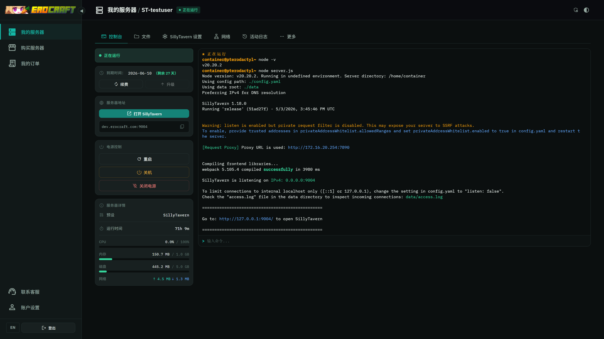

# 艾萝工坊运维管理系统

**中文** · [English](README.md)



以 Wings 为唯一运行时依赖的服务器租赁管理平台。提供面向终端用户的控制台 / 文件 / 计费 / 注册 / 续费 / 在线客服界面，以及管理员侧的服务器、用户、主机、证书、监控告警、通知中心与计费控制台。

**主要功能：**

- **服务器生命周期** — 创建 / 暂停 / 删除 / 重装（Wings）；实时控制台（WebSocket）、文件管理、启动变量编辑
- **计费与套餐** — 订阅套餐（可配置资源限额）、试用转正、统一支付网关收银、逐笔退款与交付确认
- **优惠券与邀请返利** — 优惠券模板（定额 / 折扣）、邀请码与返利奖励
- **免费 AI 额度** — 基于 NewAPI 网关的按套餐 AI API 额度；下单自动开通密钥，管理员可重置 / 吊销 / 调整配额与模型
- **在线客服与小程序** — 内置实时客服聊天（支持文字与图片附件）及微信小程序账号绑定与收银接口
- **隧道** — 基于 Cloudflare 的按服务器隧道管理（用户侧 + 管理侧）
- **证书** — acme.sh 集成，自动扫描来源、多目标部署（本机文件 / 远程 nginx）、Webhook 续签回调
- **监控与告警** — 按节点采集主机指标（CPU / 内存 / 磁盘 / 网络）、可配置告警阈值、探针健康检查与多通道通知（邮件 / 企业微信）
- **多语言** — 中文（zh-CN）与英文（en），完整 i18n 覆盖

---

## 一、介绍

### 1.1 软件构成

本仓库提供两个独立可部署单元：

| 单元 | 位置 | 作用 |
|---|---|---|
| Manager | 仓库根目录 | 后端 API + 后台定时任务 + Vue SPA。 |
| Agent | `agent/` | 节点主机指标采集 / 探针 / 证书部署 / Wings 服务控制，部署在每台受管主机上。 |

Manager 后端由两个独立 OS 进程组成，共享 `app/` 代码与同一个数据库：

- `manager-web`：FastAPI + Uvicorn（`--workers 1`），监听 `:5001`，提供 REST API、控制台 WebSocket 与客服实时流（SSE）。
- `manager-jobs`：单实例运行的 APScheduler 进程，负责监控采集、通知发送、订单/退款重试、自动暂停/删除、证书扫描与分发等定时任务。

### 1.2 外部依赖

**运行时硬依赖**：

| 依赖 | 用途 |
|---|---|
| Wings | 容器生命周期、电源、控制台、文件（Manager 直接调用各节点 Wings HTTPS 接口与控制台 WS） |
| MySQL / MariaDB | 核心数据存储。Manager 自有表使用 `manager_` 前缀，与 Pterodactyl 面板表共存于同一数据库 |
| nginx | 对外反向代理，同时承载前端 SPA 静态文件与 API 反代 |
| acme.sh | 证书签发 / 续签，由 Manager 后台调用 CLI |

**与 Pterodactyl Panel 的关系**：Manager 运行时独立于 Panel 进程，仅通过 MySQL、Wings 和 Agent 交互。Manager 读写的面板表（`users`、`servers`、`nodes`、`allocations`、`egg_variables`、`server_variables`）以及 `nodes.daemon_token` 的 Laravel 加密格式均遵循 Wings 生态约定。环境中可同时部署 Pterodactyl Panel 共用同一数据库作为底层应急手段。

### 1.3 进程拓扑

```
             浏览器
               │
               ↓
          nginx :80/:443
               │
    ┌──────────┴───────────┐
    │                      │
    ↓                      ↓
SPA (静态文件)      manager-web :5001  ──直读/写──→  MySQL
                           │
                           ├──HTTPS──→  Wings :8443    （每个节点）
                           │
                           └──HTTPS──→  Agent :48765   （每台受管主机）
                           ↑
                           │
                 manager-jobs (APScheduler)  ─── 定时拉取 Agent / 跑自动化任务
```

### 1.4 技术栈

| 层 | 选型 |
|---|---|
| 后端 | Python 3.12, FastAPI, SQLAlchemy 2 (async), Pydantic v2, APScheduler, Alembic |
| 前端 | Vue 3.5, Vite 6, TypeScript, vue-i18n, ECharts, xterm.js, CodeMirror 6 |
| 数据库 | MySQL / MariaDB |
| Agent | Python 3.12+, FastAPI, httpx, PyYAML, cryptography（标准库解析 `/proc`，无 psutil 依赖） |
| 证书 | acme.sh |

### 1.5 仓库结构

```
app/                FastAPI 后端代码
  api/routers/      HTTP 路由
  services/         业务逻辑（panel_db, wings, agent_client, cert_manager, billing, notifications, ...）
  jobs/             manager-jobs 入口与定时任务
  schemas/          Pydantic 模型
  db/               ORM 模型 + AsyncSession
  core/             配置、安全、契约、时间工具
agent/              节点 Agent 源码
alembic/            数据库迁移脚本
contracts/          前后端与 Agent 共享的错误码及协议模型
frontend/           Vue 3 SPA
scripts/            契约生成脚本与生产发版脚本（scripts/deploy/）
templates/          邮件模板 JSON
.env.example        环境变量模板
```

---

## 二、部署

### 2.1 前置条件

- Linux x86_64（Debian 12+ / Ubuntu 22.04+）
- 至少一台 Wings 节点与一个可访问的 MySQL / MariaDB 实例（已初始化面板表结构）
- Python 3.12+、Node.js 22+、nginx
- Manager 所在主机已安装 acme.sh

### 2.2 Manager 后端

```bash
sudo mkdir -p /opt/erocraft_manager
sudo chown $USER:$USER /opt/erocraft_manager
git clone https://github.com/vvb7456/Erocraft_Manager.git /opt/erocraft_manager
cd /opt/erocraft_manager

python3.12 -m venv venv
venv/bin/pip install --upgrade pip
venv/bin/pip install -r requirements.txt

cp .env.example .env
$EDITOR .env
```

`.env` 中**必须填写**：

| 变量 | 说明 |
|---|---|
| `SECRET_KEY` | ≥32 字符。可通过 `python -c "import secrets; print(secrets.token_hex(32))"` 生成 |
| `DB_HOST` / `DB_PORT` / `DB_USER` / `DB_PASSWORD` / `DB_NAME` | 数据库连接信息 |
| `PANEL_APP_KEY` | 用于解密 `nodes.daemon_token` 的 Laravel `APP_KEY`（需与 Panel `.env` 中的 `APP_KEY` 一致） |
| `CERT_ACME_SH_HOME` | acme.sh 安装目录 |
| `CERT_ACME_SH_BIN` | acme.sh 可执行文件路径 |

执行数据库迁移并启动 systemd 服务：

```bash
venv/bin/alembic -c alembic.ini upgrade head
sudo systemctl start erocraft-manager-web erocraft-manager-jobs
sudo systemctl status erocraft-manager-web erocraft-manager-jobs
```

*（注：数据库迁移需显式执行，服务启动时不会自动跑迁移。）*

### 2.3 前端

```bash
cd frontend
npm ci
npx vite build           # 输出至 ../static/dist/
bash build-fonts.sh      # 重建 Material Symbols 图标字体子集
```

### 2.4 nginx

最小可用反代配置（HTTPS 请自行追加 `listen 443 ssl;` 与证书路径）：

```nginx
server {
    listen 80;
    server_name panel.example.com;

    # API、控制台 WS 与客服 SSE
    location /api/ {
        proxy_pass http://127.0.0.1:5001;
        proxy_http_version 1.1;
        proxy_set_header Upgrade $http_upgrade;
        proxy_set_header Connection "upgrade";
        proxy_set_header Host $host;
        proxy_set_header X-Forwarded-For $proxy_add_x_forwarded_for;
        proxy_set_header X-Forwarded-Proto $scheme;
        proxy_read_timeout 120s;
    }

    location / {
        root /opt/erocraft_manager/static/dist;
        try_files $uri /index.html;
    }
}
```

### 2.5 节点 Agent

每台受管主机部署一个 Agent，运行目录约定为 `/opt/erocraft-agent`（与仓库内的 `agent/` 区分）：

```bash
sudo mkdir -p /opt/erocraft-agent
cd /opt/erocraft-agent
python3 -m venv venv
venv/bin/pip install -r /path/to/erocraft_manager/agent/requirements.txt
sudo cp -r /path/to/erocraft_manager/agent ./agent

sudo cp agent/config.example.yaml ./agent.yaml
sudo $EDITOR ./agent.yaml
```

`agent.yaml` 关键字段：

| 字段 | 含义 |
|---|---|
| `agent.role` | `wings_node` 或 `generic_host` |
| `agent.bind` | 监听地址，默认 `0.0.0.0:48765` |
| `agent.token` | Bearer Token（留空首次启动时会自动生成；Manager 侧加密存储） |
| `agent.allow_ips` | 可选，源 IP 白名单 |
| `wings.config_path` | `wings_node` 模式下指向 `/etc/pterodactyl/config.yml` |
| `cert_install_targets` | 可选，命名的证书文件部署目标（`cert_path`、`key_path`、`reload_cmd`） |

配置 systemd 服务：

```bash
sudo cp agent/erocraft-agent.service /etc/systemd/system/
sudo systemctl daemon-reload
sudo systemctl enable --now erocraft-agent
```

接入：在 Manager 后台 → **主机管理 → 新增**，填入 Agent 地址（`https://<node>:48765`）和 Token，保存时会自动探测连通性。

### 2.6 发布与升级（`scripts/deploy/`）

生产环境通过发布脚本从 GitHub Releases 拉取构建产物（`frontend-dist-*`、`manager-backend-*`、`agent-*`），解压至 `releases/<tag>/` 并原子切换 `current` 软链：

```bash
bash /opt/erocraft/deploy/deploy-frontend.sh [tag]
bash /opt/erocraft/deploy/deploy-backend.sh  [tag]
bash /opt/erocraft/deploy/deploy-agent.sh    [tag]
```

不传参数或传 `main` 时会自动解析最近一次 `main-<sha>` 预发布版本；脚本默认保留最近 5 个版本，健康检查失败时自动回滚至上一版本。

### 2.7 数据库迁移

Manager 自有表均以 `manager_` 为前缀，Alembic 迁移仅作用于这些表：

```bash
venv/bin/alembic -c alembic.ini current
venv/bin/alembic -c alembic.ini history
venv/bin/alembic -c alembic.ini upgrade head
venv/bin/alembic -c alembic.ini revision --autogenerate -m "..."
```

---

## 三、运维

### 3.1 服务管理与日志

```bash
sudo systemctl {start|stop|restart|status} erocraft-manager-web erocraft-manager-jobs
```

| 文件 / 命令 | 内容 |
|---|---|
| `journalctl -u erocraft-manager-web -f` 或 `logs/manager-web.log` | Web API 访问与应用日志 |
| `journalctl -u erocraft-manager-jobs -f` 或 `logs/manager-jobs.log` | 定时任务日志 |
| `journalctl -u erocraft-agent -f` | 节点 Agent 日志 |
| `journalctl -u wings -f` | Wings 服务日志 |

日志级别由 `.env` 中的 `LOG_LEVEL` 控制（`DEBUG / INFO / WARNING / ERROR`）。

### 3.2 定时任务

`manager-jobs` 周期性执行以下任务（`.env` 仅作初始默认值，运行时配置以管理后台「设置」与「通知中心」为准）：

| 任务 | 触发周期 | 说明 |
|---|---|---|
| 监控采集 | 每 `MONITOR_INTERVAL_SEC` 秒（默认 60 秒） | 并发拉取所有启用主机的 `/v1/metrics` 指标并评估告警规则 |
| 通知队列发送 | 每 5 秒 | 发送队列中的邮件与企业微信通知 |
| 订单同步与重试 | 每 1～3 分钟 | 关闭超时未付订单、同步网关状态、重试待交付服务器与退款 |
| 证书扫描与自动分发 | 每 10 分钟 | 扫描本机 acme.sh 证书源与各主机已部署指纹，变动时自动下发 |
| 令牌与监控数据清理 | 每小时 | 清理过期验证令牌/会话，并清理超过 `MONITOR_RETENTION_DAYS`（默认 30 天）的历史监控样本 |
| 服务器生命周期与提醒 | 每日 `AUTOMATION_RUN_HOUR:MINUTE` | 执行到期自动暂停、宽限期后自动删除及到期提醒邮件 |
| 证书到期巡检 | 每日 | 检查即将到期的证书并向管理员发送提醒 |

### 3.3 证书

- **来源**：扫描 `CERT_ACME_SH_HOME` 目录 + acme.sh 元数据
- **续签**：调用 `CERT_ACME_SH_BIN`
- **部署目标**：Wings 默认证书路径，或远程主机上命名的 `file` 目标（经 Agent 原子写入并执行 `reload_cmd`）
- **Webhook**：acme.sh `reloadcmd` 或 `deploy hook` 可携带请求头 `X-Cert-Webhook-Token`（配置 `CERT_WEBHOOK_TOKEN`）回调 `POST /api/certificates/webhook/renewed`，触发即时重扫与自动下发

### 3.4 主机 / 节点维护

| 操作 | 路径 |
|---|---|
| 新增主机 | 后台 → 主机管理 → 新增（填写 endpoint URL + token） |
| 编辑 Wings 配置 | 主机详情 → Wings 标签；保存后 Manager 写 `nodes` 表并推送至 Wings `/api/update` |
| 重启 Wings | 主机详情 → Wings → 重启（经 Agent 触发 `systemctl restart wings`） |
| 端口分配 | 主机详情 → 分配 标签 |
| 告警阈值 | 主机详情 → 设置 标签（按主机覆盖全局默认规则） |

### 3.5 备份

| 项目 | 命令 / 路径 |
|---|---|
| 数据库 | `mysqldump --single-transaction <DB_NAME> > db.sql` |
| 配置 | `.env`、`agent.yaml`（每台主机）、nginx 站点配置 |
| 客服图片 | `SUPPORT_IMAGE_DIR`（默认 `/opt/erocraft_manager/storage/support`，总容量受 `SUPPORT_IMAGE_MAX_MB` 限制） |
| 证书 | 整个 `CERT_ACME_SH_HOME` 目录 |
| 容器卷 | 各 Wings 节点上的 `/var/lib/pterodactyl/volumes` |

### 3.6 故障排查速查

| 现象 | 排查方向 |
|---|---|
| Web 服务启动失败 | 查看 `journalctl -u erocraft-manager-web` 或 `logs/manager-web.log`；检查 `.env` 必填项与数据库迁移版本 |
| 用户控制台连不上 | 检查 nginx 是否转发 `Upgrade` / `Connection` 头；检查 Manager 到节点 Wings 端口的连通性 |
| 监控无数据 | 主机详情 → 设置 → 探测；检查节点 `systemctl status erocraft-agent`；核对 Token 与证书域名 |
| 证书未续签 | 在 `logs/manager-jobs.log` 中搜索 `cert`；手动执行 `${CERT_ACME_SH_BIN} --renew -d <domain> --force` 排查 |
| 创建服务器失败 | 查看 `logs/manager-web.log` 中的 `lifecycle` 日志；失败会自动执行补偿回滚 |
| 面板字段解密报错 | 确认 `PANEL_APP_KEY` 与生成 `nodes.daemon_token` 时的 `APP_KEY` 一致 |

### 3.7 常用命令

```bash
venv/bin/alembic -c alembic.ini current                      # 查看当前迁移版本
tail -f logs/manager-jobs.log                                # 跟踪定时任务日志
curl -fsS http://127.0.0.1:5001/api/version                  # 本地健康检查
python3 scripts/generate-contracts.py --check                # 校验前后端与 Agent 共享错误码契约
```

---

## 许可证

见 [LICENSE](LICENSE)。
