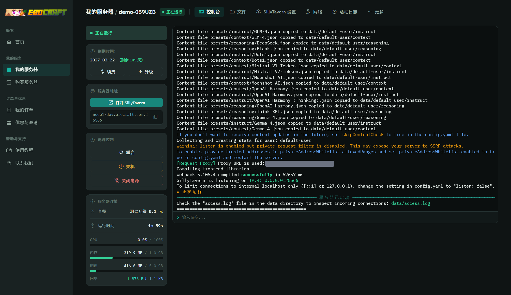

# 艾萝工坊运维管理系统

**中文** · [English](README.md)



基于 Wings 的服务器租赁与容器托管管理平台。提供面向终端用户的控制台、文件、计费续费与在线客服界面，以及覆盖服务器、预设、节点、主机、证书、监控告警、通知与计费的管理后台。

**主要功能：**

- **服务器生命周期** — 基于 Wings 完成创建、暂停、删除与重装；提供 WebSocket 实时控制台、文件管理、SFTP 鉴权与启动变量编辑
- **预设与节点管理** — 内置预设组、预设（配置/脚本继承、JSON 导入导出、变量规则校验）、地域、Wings 节点与端口分配管理
- **计费与套餐** — 订阅套餐、试用转正、统一支付网关收银、逐笔退款与兑换码批次管理
- **优惠券与邀请返利** — 定额/折扣优惠券模板与邀请返利机制
- **免费 AI 额度** — 基于 NewAPI 网关按套餐自动开通与管理 AI API 配额
- **在线客服与小程序** — 内置实时客服聊天（文字 + 图片）及微信小程序账号绑定与收银
- **隧道与证书** — 按实例配置 Cloudflare 隧道；集成 `acme.sh` 自动签发、续签与跨主机证书分发
- **监控与告警** — 主机指标采集、探针巡检、阈值规则与邮件 / 企业微信多通道通知
- **多语言** — 完整中文（`zh-CN`）与英文（`en`）支持

---

## 一、架构概览

### 1.1 部署单元

| 单元 | 路径 | 作用 |
|---|---|---|
| Manager | 仓库根目录 | 后端 API（`manager-web`，`:5001`）、定时任务（`manager-jobs`）与 Vue SPA |
| Agent | `agent/` | 受管主机指标采集、探针、证书写入与 Wings 服务控制（`:48765`） |

### 1.2 外部依赖

| 依赖 | 用途 |
|---|---|
| Wings | 各节点容器守护进程（控制接口 + `/api/remote/*` 回调） |
| MySQL / MariaDB | 主数据存储 |
| nginx | 反向代理与前端静态资源服务 |
| acme.sh | 证书签发与续签工具 |

### 1.3 与 Pterodactyl 生态的关系

本项目完全独立运行，不依赖也不需要部署 Pterodactyl Panel。Manager 直接实现 Wings 控制客户端与 `/api/remote/*` 守护进程回调协议，同时保持对标准 Wings 二进制、节点 `config.yml` 配置、`PTDL_v1`/`PTDL_v2` 预设 JSON 格式及生态表结构的兼容，既支持全新部署，也支持从存量 Pterodactyl 数据库原地平滑接管。

### 1.4 进程拓扑

```
             浏览器
               │
               ↓
          nginx :80/:443
               │
    ┌──────────┴───────────┐
    │                      │
    ↓                      ↓
SPA (静态文件)      manager-web :5001  ──读写──→  MySQL
                           │   ↑
      HTTPS + WS (/api/*)  │   │  HTTPS (/api/remote/*)
                           ↓   │
                       Wings :8443       （各容器节点）
                           │
                      Agent :48765       （各受管主机，由 Manager 拉取）
                           ↑
                           │
                 manager-jobs (APScheduler)
```

### 1.5 技术栈与目录结构

- **后端**：Python 3.12, FastAPI, SQLAlchemy 2 (async), Pydantic v2, APScheduler, Alembic
- **前端**：Vue 3.5, Vite 6, TypeScript, vue-i18n, ECharts, xterm.js, CodeMirror 6
- **Agent**：Python 3.12+, FastAPI, httpx, PyYAML, cryptography（标准库解析 `/proc`，无 psutil 依赖）

```
app/          FastAPI 后端（api/、services/、jobs/、schemas/、db/、core/）
agent/        主机 Agent 源码
alembic/      数据库迁移脚本
contracts/    前后端与 Agent 共享错误码及协议模型
frontend/     Vue 3 SPA
scripts/      契约检查与生产发版脚本（scripts/deploy/）
templates/    邮件模板 JSON
```

---

## 二、部署说明

### 2.1 后端服务

```bash
git clone https://github.com/vvb7456/Erocraft_Manager.git /opt/erocraft_manager
cd /opt/erocraft_manager

python3.12 -m venv venv
venv/bin/pip install -U pip -r requirements.txt

cp .env.example .env
$EDITOR .env
```

`.env` 必填配置：

| 变量 | 说明 |
|---|---|
| `SECRET_KEY` | ≥32 字符随机密钥（`python -c "import secrets; print(secrets.token_hex(32))"`） |
| `DB_HOST` / `DB_PORT` / `DB_USER` / `DB_PASSWORD` / `DB_NAME` | 数据库连接信息 |
| `PANEL_APP_KEY` | 用于加密节点通信令牌的 AES-256-CBC 密钥（`python -c "import base64, os; print('base64:' + base64.b64encode(os.urandom(32)).decode())"`） |
| `CERT_ACME_SH_HOME` / `CERT_ACME_SH_BIN` | `acme.sh` 安装目录与可执行文件路径 |

执行迁移并启动服务：

```bash
venv/bin/alembic -c alembic.ini upgrade head
sudo systemctl start erocraft-manager-web erocraft-manager-jobs
```

### 2.2 前端与 nginx

```bash
cd frontend
npm ci
npx vite build           # 构建至 ../static/dist/
bash build-fonts.sh      # 重建 Material Symbols 图标字体子集
```

```nginx
server {
    listen 80;
    server_name console.example.com;
    client_max_body_size 100m;

    location /api/ {
        proxy_pass http://127.0.0.1:5001;
        proxy_http_version 1.1;
        proxy_set_header Upgrade $http_upgrade;
        proxy_set_header Connection "upgrade";
        proxy_set_header Host $host;
        proxy_set_header X-Real-IP $remote_addr;
        proxy_set_header X-Forwarded-For $proxy_add_x_forwarded_for;
        proxy_set_header X-Forwarded-Proto $scheme;
        proxy_buffering off;
        proxy_read_timeout 300s;
    }

    location / {
        root /opt/erocraft_manager/static/dist;
        try_files $uri /index.html;
    }
}
```

### 2.3 主机 Agent 与 Wings 节点接入

在每台受管主机部署 `/opt/erocraft-agent`：

```bash
sudo mkdir -p /opt/erocraft-agent && cd /opt/erocraft-agent
python3 -m venv venv
venv/bin/pip install -r /path/to/erocraft_manager/agent/requirements.txt
sudo cp -r /path/to/erocraft_manager/agent ./agent
sudo cp agent/config.example.yaml ./agent.yaml
sudo cp agent/erocraft-agent.service /etc/systemd/system/
sudo systemctl daemon-reload && sudo systemctl enable --now erocraft-agent
```

接入 Wings 容器节点：
1. 在后台 **主机管理 → 地域 / Wings 节点** 创建地域与节点，导出节点 `config.yml` 写入 `/etc/pterodactyl/config.yml` 并启动 `wings`。
2. 在 **主机管理 → 新增** 填入主机 Agent 地址（`https://<host>:48765`）、Token 并绑定该节点。

### 2.4 发布与升级（`scripts/deploy/`）

```bash
bash /opt/erocraft/deploy/deploy-frontend.sh [tag]
SKIP_ALEMBIC=1 bash /opt/erocraft/deploy/deploy-backend.sh [tag]
bash /opt/erocraft/deploy/deploy-agent.sh    [tag]
```

默认拉取最新 `main-<sha>` 构建包，在 `releases/<tag>/` 下保留最近 5 个版本并原子切换 `current` 软链，健康检查失败自动回滚；包含新增数据库迁移时去掉 `SKIP_ALEMBIC=1`。

---

## 三、日常运维

### 3.1 服务与日志

```bash
sudo systemctl {start|stop|restart|status} erocraft-manager-web erocraft-manager-jobs
journalctl -u erocraft-manager-web -f        # 或 tail -f logs/manager-web.log
journalctl -u erocraft-manager-jobs -f       # 或 tail -f logs/manager-jobs.log
journalctl -u erocraft-agent -f
journalctl -u wings -f
```

### 3.2 后台定时任务（`manager-jobs`）

| 任务 | 周期 | 说明 |
|---|---|---|
| 监控采集 | 60 秒 | 拉取各启用主机 `/v1/metrics` 指标并评估告警规则 |
| 通知分发 | 5 秒 | 投递队列中的邮件与企业微信通知 |
| 计费同步与重试 | 1～3 分钟 | 关闭超时未付订单、同步网关状态、重试实例开通与退款 |
| 证书扫描与分发 | 10 分钟 | 扫描 `acme.sh` 证书源并在更新后自动下发至目标主机 |
| 过期数据清理 | 1 小时 | 清理过期令牌、历史监控样本（30 天）与实例活动日志（90 天） |
| 生命周期与提醒 | 每日 | 执行到期暂停、宽限期销毁与到期提醒邮件 |

### 3.3 常用检查与备份

```bash
curl -fsS http://127.0.0.1:5001/api/version
venv/bin/alembic -c alembic.ini current
python3 scripts/generate-contracts.py --check
python3 scripts/check-agent-contracts.py
mysqldump --single-transaction --no-tablespaces --routines <DB_NAME> > db.sql
```

---

## 许可证

见 [LICENSE](LICENSE)。
